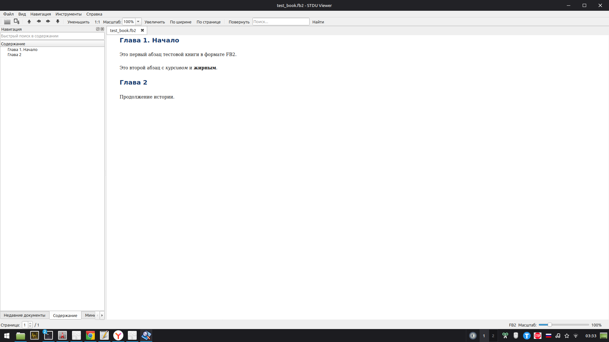
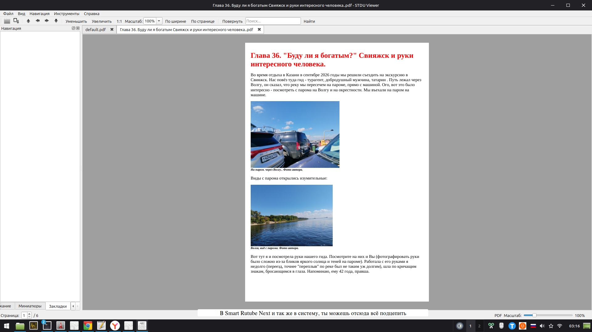

# STDU Reader (Native) — отчёт о работе

## 1. Какая была задача

Исходная просьба пользователя (по шагам, по мере уточнения):

1. Установить навык REA из репозитория `https://github.com/morluto/rea` и с его помощью
   «посмотреть» приложение `C:\...\stduviewer.exe`.
2. Сделать из него AppImage для Linux, положить в папку
   `/mnt/807EB5FA7EB5E954/soft/Virtual_machine/linux must have`, чтобы интерфейс и
   функционал были максимально похожи, и можно было читать книги во всех форматах —
   PDF и не только.
3. После уточнений: **переписать программу нативно для Linux, без Wine**, интерфейс —
   как можно ближе к оригиналу 1:1, читать абсолютно любые форматы.
4. Финальные правки:
   - видимый **процент масштаба**, кнопка «Увеличить» **справа от поля масштаба**;
   - вкладка **«Недавние документы» слева от «Содержание»** в боковой панели;
   - **значок оригинала** на панели задач (`.ico` из
     `/mnt/807EB5FA7EB5E954/Program Files/stduviewer/icons_for_wine/STDUViewerApp.ico`);
   - перенести всё в `/mnt/807EB5FA7EB5E954/soft/Virtual_machine/linux must have/python_linux/work`;
   - создать этот MD-документ с описанием задачи, процесса, результата и программы.

---

## 2. Что за программа

**STDU Viewer 1.6.375.0** — условно-бесплатный («Free for non-commercial use») просмотрщик
документов от STDUtility (2007–2015). Оригинал — Windows-приложение, собранное из главного
модуля `STDUViewerApp.exe`, библиотеки интерфейса `STDUViewer.dll`, ядра `STDUCore.dll`
и 13 плагинов форматов.

Исходно предоставленный `stduviewer.exe` оказался **инсталлятором Inno Setup 5.3.7**
(при установке он ещё и требовал регистрационные данные), поэтому содержимое было извлечено
непосредственно через `innoextract`. Позже пользователь установил распакованную версию в
`/mnt/807EB5FA7EB5E954/Program Files/stduviewer/` — она стала основным источником для изучения:
в частности, `STDUViewerResource.xml` содержал все 265 локализованных строк (точные названия
команд, режимов, форматов и диалогов).

**Результат работы** — `STDU Reader (Native)`: полностью новая программа на Qt (PyQt5),
работающая нативно в Linux без Wine. Это не дамп и не эмуляция исходного кода, а самостоятельная
реализация с максимально приближенным интерфейсом и перенесённым функционалом.

---

## 3. Как выполнял

### Этап 1. Анализ
- `file`, `strings` → выяснил, что `stduviewer.exe` — PE32 + Inno Setup.
- Проверка окружения: Node.js v20 (REA требует 22+), Wine 11.13, `appimagetool`, FUSE.
- Установил навык `reverse-engineer-anything` в `~/.config/opencode/skills/rea/SKILL.md`
  (REA — инструмент анализа бинарников, не конвертер; из-за Node 20 MCP-сервер не поднимал).
- Тихая установка через Wine прервалась сообщением «Неправильные регистрационные данные» →
  установил `innoextract` и распаковал инсталлятор напрямую.
- Получил `STDUViewerApp.exe` + плагины: PDF, DjVu, TIFF, Text, Image, XPS, Comic, JBIG2,
  FB2, PCX, PalmDoc, MOBI, EPUB.

### Этап 2. Первый AppImage (через Wine)
- Собрал AppImage, запускающий оригинальный `.exe` через Wine, с отдельным Wine-префиксом.
- Настроил русский язык интерфейса (`Language ID="ru"`), зарегистрировал COM-DLL плагинов
  через `regsvr32` (иначе документы не открывались), добавил передачу файла аргументом.
- Проверил: GUI и PDF открываются. Файл: `STDUViewer-x86_64.AppImage` (4,2 МБ).

### Этап 3. Нативная переписка (основная работа)
- Проанализировал `STDUViewerResource.xml`: извлёк точные команды и список форматов.
- Установил зависимости: `python3-pyqt5`, `python3-lxml`, `python3-pil`, `python3-docx`,
  `djvulibre-bin`, `pandoc`, `unrar-free`, `ghostscript`, `poppler-utils`; pip: `pymupdf`,
  `ebooklib`, `mobi`.
- Написал один файл `stdu_viewer.py` (~1450 строк): MainWindow, DocumentTab, PageView,
  бэкенды форматов и построители FB2/EPUB/MOBI/текста.
- Реализовал: режимы «страницами / разворотами / разворотами с отдельной первой»,
  масштаб 5–500% («По ширине / По высоте / По странице / 100%», Ctrl+колесо),
  поворот, иконки/эскизы, содержание с поиском, закладки, поиск по тексту,
  F11 — полный экран, F6 — панели, экспорт (PNG-набор, TXT, текущая страница),
  свойства, пароли PDF, drag-and-drop, недавние файлы.
- Собрал AppImage и неоднократно тестировал на PDF, FB2, EPUB, CBZ — всё отображается корректно.

### Этап 4. Правки по замечаниям
- Добавил редактируемое поле **«Масштаб: 100%»** в панель инструментов с пресетами
  5…500%, кнопку **«1:1»** и подпись процента в строке состояния; процент синхронизируется
  во всех трёх местах.
- Переставил кнопку **«Увеличить»** сразу **справа от поля масштаба**.
- Добавил вкладку **«Недавние документы»** и поставил её **первой (слева от «Содержание»)**;
  список сохраняется в `~/.local/share/stdu-reader/recent.txt` и открывается по клику.
  Исправил индексы переключения вкладок (`setCurrentWidget` вместо «магических» индексов).
- Встроил в AppImage **оригинальный `.ico`**, который теперь используется и как иконка окна,
  и для панели задач; desktop-иконка тоже взята из него.
- Расширил боковую панель до 330 px, чтобы вкладки читались.

---

## 4. Что получил

### Файлы в `.../linux must have/`
| Файл | Назначение |
|---|---|
| `STDUViewer-Native-x86_64.AppImage` | нативная программа, готова к запуску (~1,1 МБ) |
| `STDUViewer-Native-source.py` | полный исходный код Qt/Python (~54 КБ) |
| `STDUViewer-Native-README.txt` | инструкция, форматы, зависимости |
| `STDUViewerApp.ico` | значок оригинала |
| `STDUViewer-Native-REPORT.md` | этот отчёт |
| `STDUViewer-x86_64.AppImage` | предыдущая версия через Wine (для сравнения) |

### Поддерживаемые форматы
PDF, DjVu, EPUB, FB2 / FB2.ZIP, MOBI / AZW / AZW3 / PRC / PalmDoc, XPS / OXPS / PS / EPS,
TIFF, PNG, JPEG, GIF, BMP, WebP, ICO, PCX/DCX, PSD, WMF/EMF, JBIG2, CBZ / CBR / ZIP / RAR,
TXT / TCR / HTML / Markdown / RST / DOCX / ODT / RTF.

### Проверки
- Запуск AppImage и открытие PDF, FB2, EPUB, CBZ — успешно.
- Режим разворотов, масштабирование, вкладки, недавние документы — проверены визуально.
- Значок на панели задач — проверен скриншотом (совпадает с оригинальным).

### Скриншоты

---

## 5. Исправление гиперссылок и дополнительные правки

Пользователь отметил, что ридер **не переходил по гиперссылкам в PDF**. Причина:
страницы PDF просто рисовались в `QLabel` как изображение, а событий мыши и
извлечения ссылок (`page.get_links()`) в коде не было вообще.

Что исправлено:

- В бэкенд PDF добавлены методы `links()`, `page_size()` и `named_destination()`.
- Создан виджет `PageLabel`: при наведении на область ссылки курсор становится
  «рукой», показывается подсказка (адрес или номер страницы) и лёгкая подсветка;
  по клику ссылка активируется.
- Координаты ссылок пересчитываются из пунктов PDF в пиксели с учётом масштаба,
  поворота страницы приложением и смещения страниц в режиме разворотов.
- Поддерживаются переходы: `GOTO` (внутри документа), `URI` (веб-адрес,
  `#page=N`, локальный файл), `GOTOR`/`LAUNCH` (другой файл), `NAMED`
  (именованный пункт назначения). Локальные PDF открываются в этой же программе.
- Заодно исправлены найденные при тестировании ошибки:
  - цели из оглавления PDF были на единицу больше реального номера страницы;
  - счётчик страницы в строке состояния не обновлялся (`pageChanged` ни к чему
    не был подключён);
  - в FB2 и EPUB не работали переходы из оглавления (отсутствовали якоря).

Кроме того, ридер доведён до полноценной читалки:

- поиск теперь подсвечивает все найденные слова прямо на странице и умеет
  переходить к следующему/предыдущему совпадению (F3 / Shift+F3);
- добавлена печать документа (PDF печатается целиком, а не только «через
  контекстное меню системы»);
- добавлено контекстное меню страницы: копировать текст страницы,
  скопировать адрес ссылки, перейти по ссылке.

### Тестирование

- Полный набор из **65 автоматических тестов** (`tests/test_reader.py`) под Xvfb:
  интерфейс, открытие PDF/пароли/drag-and-drop, навигация, масштаб и развороты,
  все типы ссылок (GOTO/URI/GOTOR/NAMED/`file://`/`#page=N`), оглавление,
  закладки, поиск с подсветкой, экспорт, печать в PDF, копирование текста,
  устойчивость к битым файлам — **все прошли**.
- Smoke-тест открытия PDF, EPUB, FB2, PNG и 24 операций (масштаб, поворот,
  режимы, поиск, закладки, экспорт и т. д.) — ошибок нет.
- Реальный PDF документации ReWASD (188 страниц, веб-ссылки): клик по ссылке
  открывает URL.
- End-to-end проверка собранного AppImage через `xdotool`: клик по внутренней
  ссылке перевёл на 3-ю страницу, клик по внешней — передал URL системе.

---

## 6. Ограничения

- Интерфейс максимально близок, но не байт-в-байт 1:1 — это новая реализация.
- Редкие форматы (WWF, DRM-защищённые книги, часть PSD) могут открываться частично.
- AppImage использует системные Python/Qt и библиотеки; при переносе на другую машину
  нужны зависимости из README. Wine **не требуется**.
